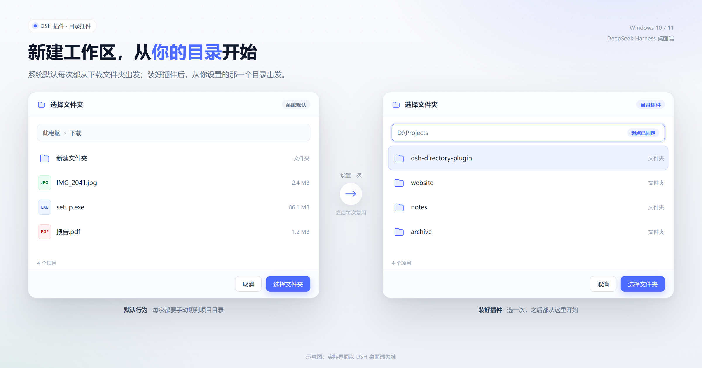
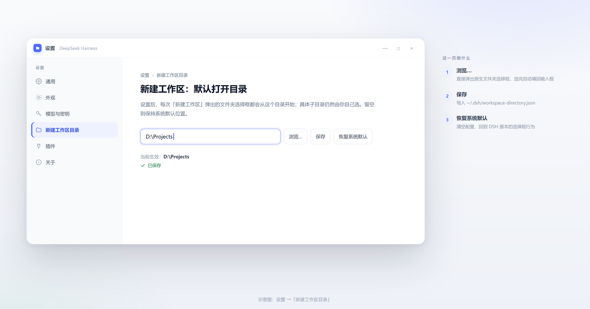
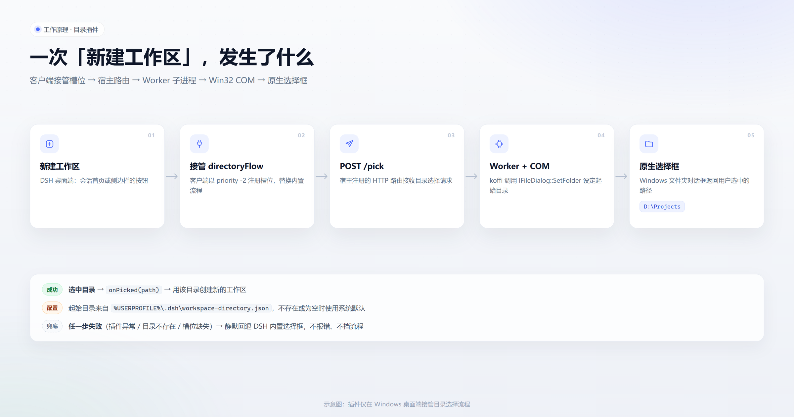

# 目录插件 · dsh-directory-plugin

**让 DeepSeek Harness 桌面端「新建工作区」永远从你自己的目录开始。**

[](LICENSE)


---

DSH 桌面端新建工作区时会直接弹出系统文件夹选择框，起点永远是系统默认位置（通常是下载
文件夹），而且这个对话框不接受任何调用参数。本插件把它换成「**默认打开在你设定的目录**」
的原生选择框：你只需要在设置里指定一次，之后每次新建工作区都从那里开始，具体子目录仍然
由你自己挑。

中文名「目录插件」，仓库/包名即英文 id：`dsh-directory-plugin`。

> 只支持 Windows：起始目录依赖 Win32 COM 的 `IFileDialog::SetFolder`。

## 预览

<p align="center">
  
</p>

<p align="center"><sub>同一操作，不同起点：默认从系统下载目录出发，插件从你设定的目录出发（示意图）</sub></p>

## 功能

- **接管目录选择流程**：替换「新建工作区」弹出的文件夹对话框，从一个可配置的目录开始。
- **设置页**：DSH 设置里新增「新建工作区目录」，可输入路径、点「浏览…」选择、保存或一键
  恢复系统默认。
- **安全回退**：插件不可用、目录被删除或对话框出错时，自动退回 DSH 内置行为，不会报错、
  不会挡住新建工作区。
- **诊断日志**：每次弹框都会记录起始目录是否生效，方便排查。

## 安装

前置条件：Windows 10/11 + DeepSeek Harness **桌面端**。

1. 把仓库克隆或下载到本地，例如 `D:\Plugins\dsh-directory-plugin`；
2. 用 DSH 自带的插件命令行把它登记进 `desktop` 配置档（`link:` 表示直接引用本地目录，
   不复制文件）：

```powershell
# 按实际情况修改这两个变量
$DSH_EXE = 'C:\Program Files\DSH\DSH NEXT.exe'   # 你的 DSH 桌面端安装位置
$PLUGIN  = 'D:\Plugins\dsh-directory-plugin'     # 本仓库所在的本地目录

$CLI = Join-Path (Split-Path $DSH_EXE) 'resources\app.asar\lib\plugin-cli.js'

$env:ELECTRON_RUN_AS_NODE = '1'
$env:DSH_HOME = "$env:USERPROFILE\.dsh"
& $DSH_EXE --expose-internals $CLI desktop add "link:$PLUGIN"
```

3. **重启 DSH 桌面端**（插件组合在启动时读取）。
4. 打开 设置 →「新建工作区目录」，选一个目录并保存，然后试一次「新建工作区」。

## 使用

1. 设置 →「新建工作区目录」；
2. 点「浏览…」选目录，或手动输入路径，点「保存」。「浏览…」从输入框里当前的路径打开
   （还没保存也可以），选完要点「保存」才生效；
3. 之后每次「新建工作区」，选择框都会从该目录开始；
4. 「恢复系统默认」清空配置，回到 DSH 原来的行为。

选择框是 DSH 窗口的模态对话框：它居中显示在 DSH 上面，开着的时候 DSH 窗口点不动。点了之后
马上切到别的程序的话，选择框不会抢前台，任务栏按钮会闪烁提示。

同一时刻只会有一个选择框：设置页的「浏览…」开着时再点「新建工作区」（或者反过来），
后来的那个会提示「已经有一个文件夹选择框开着」，不会再弹出第二个框。

设置页：

<p align="center">
  
</p>

<p align="center"><sub>设置 →「新建工作区目录」：输入框、浏览…、保存、恢复系统默认（示意图）</sub></p>

配置示例（`%USERPROFILE%\.dsh\workspace-directory.json`）：

```json
{ "directory": "D:\\Projects" }
```

旧版本（`workspace-anchor.json` / `default-workspace-directory.json`）的配置会在首次读取时
自动迁移，无需手动处理；迁移完成后旧文件改名为 `*.migrated` 保留。

手动编辑时注意 JSON 里的反斜杠要写成 `\\`。文件写坏时插件按「未设置」处理并在日志里记一条
`config-corrupt`，不会覆盖你的文件；改好或在设置页重新保存即可。

## 工作原理

插件同时挂在两个平面上：

| 平面 | 文件 | 作用 |
| --- | --- | --- |
| 宿主（host） | `lib/index.js` | 注册两个同源 HTTP 路由：`/dsh-directory-plugin/config`、`/dsh-directory-plugin/pick` |
| 浏览器（client） | `client/client.js` | 接管 `conversation.hero.workspace.directoryFlow` / `sidebar.workspaces.directoryFlow` 槽位，并注册设置页 |
| 核心 | `lib/core.js` | 配置读写、目录校验、拉起对话框子进程 |
| Worker | `lib/dialog-worker.cjs` | 一次性 Node 子进程，用 koffi 直接调 Win32 COM |

弹框链路：客户端槽位 `open` → `POST /pick` → `core.pickDirectory()` 拉起 worker →
`CoCreateInstance(FileOpenDialog)` → `SHCreateItemFromParsingName` 造 `IShellItem` →
`IFileDialog::SetFolder`（vtable 第 12 槽）→ `Show()`。失败时客户端回退到桌面端内置的
`__DSH_DIRECTORY_PICKER__`。

两个路由只服务 DSH 自己的页面：浏览器标为跨站的请求返回 403，POST 必须是
`application/json`（否则 415），`/pick` 只接受 POST——避免任意网页跨站调用它们。

出错时路由返回非 2xx 和 `{ code, error, detail }`：设置页按错误码显示当前界面语言的文案，
`error` 是给日志看的英文说明，堆栈只写进日志。对话框标题也由客户端按界面语言传过来。

<p align="center">
  
</p>

<p align="center"><sub>从点击「新建工作区」到原生选择框打开（示意图）</sub></p>

koffi 3.1.1 已随仓库放在 `vendor/`，安装时不需要联网。worker 只接受 koffi 3.x：随包的那份加载
不了时（比如 ARM64 机器），会依次尝试 DSH 安装目录里自带的 koffi，主版本不是 3 的一律跳过；
都不行就报错，界面回退到 DSH 自带的选择框。

## 排错

诊断日志：`%USERPROFILE%\.dsh\workspace-directory.log`（一个事件一行；超过 1MB 时旧日志改名为
`workspace-directory.log.1`，只保留这一份）

| 日志 | 含义 |
| --- | --- |
| `host-routes-registered /dsh-directory-plugin` | 宿主侧已加载、HTTP 路由就绪 |
| `pick D:\Projects\demo purpose=workspace owner=… initial={"applied":true,...}` | 选择框确实以配置目录为起点（`purpose=settings` 是设置页的「浏览…」）；`owner` 是 DSH 窗口句柄，`none` 表示当时前台不是 DSH、选择框没有父窗口 |
| `owner-reenable <句柄>` | 选择框进程在对话框开着时意外退出，已经把被它禁用的 DSH 窗口恢复 |
| `pick (cancelled) ...` | 用户取消了 |
| `pick-failed <错误码> <说明> ...` | 对话框进程出错（worker 的堆栈也在这一行），界面会回退到系统默认行为 |
| `route-failed <路径> <说明>` | 路由处理器里出了没料到的异常，已回 500；请附上这一行提 issue |
| `config-corrupt <文件> <原因>` | 配置文件不是合法 JSON（多半是反斜杠没写成 `\\`），已按未设置处理，文件原样保留 |
| `config-write-failed ...` | 保存配置失败（多为文件被其他程序占用），设置页会显示错误，稍后重试即可 |

判断是否生效：

1. 重启后日志出现 `host-routes-registered` → 宿主侧已起来；
2. 新建工作区时日志新增 `pick ... initial={"applied":true}` → 走的是本插件的对话框；
3. 若日志没有新增 `pick` 行、弹出的还是旧对话框，说明浏览器侧接管没生效：功能退化为 DSH
   原生行为，不会报错。请附上日志和现象提 issue。

## 兼容性

- Windows 10 / 11，x64（`vendor` 内置的是 win32-x64 的 koffi 二进制）。ARM64 上会改用 DSH 安装目录
  里自带的 koffi，这条路径没有在 ARM64 机器上实测过。
- 其他系统上插件能装上但不生效：设置页只显示一行说明，「新建工作区」继续用 DSH 自带的
  选择框，也不会去起注定失败的对话框进程。
- 依赖 DSH 桌面端（Next 内核）的槽位与客户端插件加载机制；如果未来版本移除或重命名这些
  槽位，插件会静默回退，不影响 DSH 本身。
- 插件不会改动 DSH 安装目录里的任何文件。

## 卸载

```powershell
$env:ELECTRON_RUN_AS_NODE = '1'
$env:DSH_HOME = "$env:USERPROFILE\.dsh"
& $DSH_EXE --expose-internals $CLI desktop remove dsh-directory-plugin
```

然后重启 DSH。配置文件与日志会留在 `%USERPROFILE%\.dsh` 下，可手动删除。

## 目录结构

```
package.json            插件清单（宿主入口 + 浏览器入口 + cordis 层）
cordis.patch.yml        往组合里插入本插件的那一行
lib/index.js            宿主插件：HTTP 路由
lib/core.js             配置读写 + 拉起对话框子进程
lib/dialog-worker.cjs   Win32 文件夹对话框 worker（支持起始目录）
client/client.js        浏览器 bundle：接管目录流程 + 设置页
test/                   node:test 用例（npm test，需要 Node 22+；不会弹出真实对话框）
vendor/                 随包携带的 koffi 3.1.1（只留运行时会加载的 8 个文件，约 1MB）
docs/images/            README 示意图（overview / settings / how-it-works）
LICENSE                 MIT
```

## English

**Directory Plugin** (`dsh-directory-plugin`) is a plugin for the DeepSeek Harness desktop
app on Windows. It replaces the folder chooser used by *New Workspace* with a native dialog
that opens at a directory you configure (DSH's built-in picker always starts at the system
default). It adds a settings page, falls back silently to the stock picker when anything
goes wrong, and ships koffi so no network install is needed.

## License

[MIT](LICENSE) © 2026 milu7
